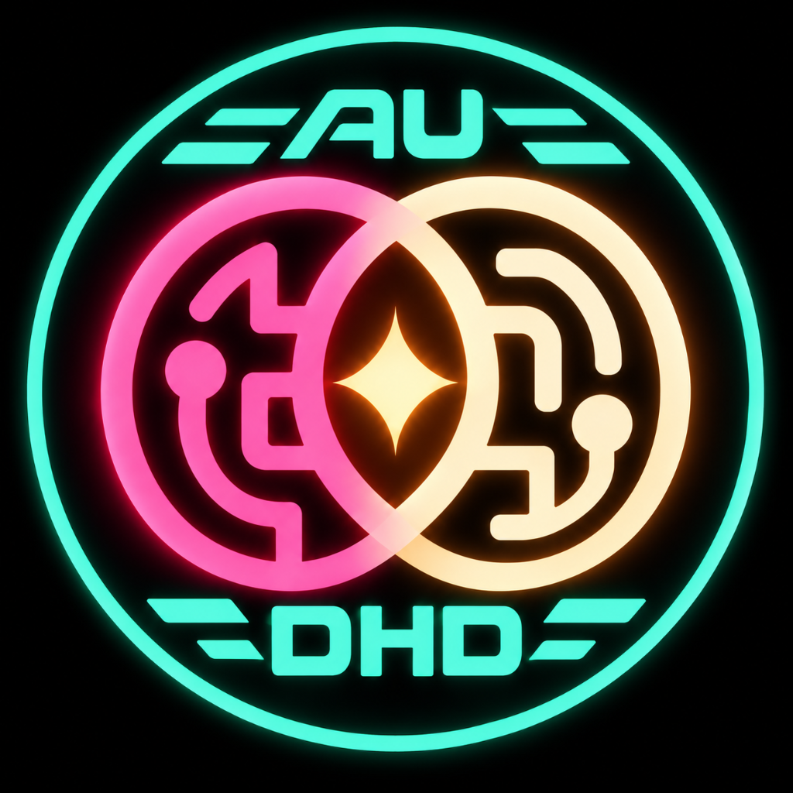

# AuDHD friendly interface guidance



Practical guidance for developers and AI agents building interfaces that are easier to understand, use, pause, resume and correct.

**Version:** v1.01 · Updated October 19, 2026

[What is this?](#what-is-this) · [Use it](#how-do-i-use-it) · [Install it](#how-do-i-install-it) · [What else?](#what-else-should-i-know)

## What is this?

- **[Guide](GUIDE.md):** Rules for making context, relationships, actions and recovery understandable. Use it to design or review an interface, with or without AI.
- **[Skill](SKILL.md):** A workflow for AI development agents: understand your codebase, apply the Guide and verify improvements.
- **[Examples](EXAMPLES.md):** An [annotated screenshot gallery](examples/GALLERY.md), worked patterns, [runnable React and Svelte interfaces](examples/recording-review/README.md), and [22 skins with chart palettes](examples/skins/README.md). Explore the choices, see the rules in action and adapt useful patterns to your own stack.

## How do I use it?

Select or name the `audhd-ui-guide` skill, then choose a prompt below. Paste prompts into your agent’s chat:

- **Review an existing interface:** “Use the audhd-ui-guide skill. Run an AuDHD audit on this program's UI components. Report the main problems and recommended improvements before changing anything.”
- **Build a configuration dashboard:** “Use the audhd-ui-guide skill. Here are my configuration files and codebase. Build an AuDHD-friendly settings dashboard using the real defaults, dependencies and save behavior.”
- **Add a front end:** “Use the audhd-ui-guide skill. Add an AuDHD-friendly front end to this codebase. Use the existing stack, preserve behavior and permissions, and verify complete workflows.”
- **Improve a specific difficulty:** “Use the audhd-ui-guide skill. Make the selected item and its detail panel clearly connected. Preserve drafts, navigation and keyboard focus, and explain what you verified.”

Start with one task; you do not need to redesign everything. For a manual review, follow [Try one small review](#try-one-small-review). For agents without skill discovery, use [the attachment-based instructions](#use-without-skill-support).

## How do I install it?

**Choose one platform and one scope:** personal installation makes the skill available across your projects; project installation makes it available inside one application project. `~` means your home directory; paths without `~` start at the application project.

- **Download with Git:** This creates an `audhd-ui-guide` folder inside your current directory. You can run it from your chosen skills directory to install there directly:

  ```sh
  git clone https://github.com/Greyland-Fireworks/audhd-ui-guide.git
  ```

- **Codex:** Put the folder at `~/.agents/skills/audhd-ui-guide/` for personal use across projects, or `.agents/skills/audhd-ui-guide/` inside the project being worked on. See [Codex skill locations](https://learn.chatgpt.com/docs/build-skills#where-codex-loads-local-skills).
- **Claude Code:** Use `~/.claude/skills/audhd-ui-guide/` for personal use or `.claude/skills/audhd-ui-guide/` inside a project. See [Claude Code skill locations](https://code.claude.com/docs/en/skills#choose-where-skills-load).
- **Cursor:** Use `~/.cursor/skills/audhd-ui-guide/` for personal use or `.cursor/skills/audhd-ui-guide/` inside a project. Cursor also supports the `.agents/skills/` locations used by Codex; choose one location rather than installing duplicate copies. See [Cursor skill locations](https://cursor.com/docs/skills#skill-directories).
- **Keep the supporting files together:** Keep `SKILL.md`, `GUIDE.md` and the other public files in their original relative locations. Exclude ignored research, personal profiles, dependencies and build/test output when copying a working checkout.
- **Confirm it is available:** Open the application project in your agent and select or name `audhd-ui-guide`. Check the skill selector; refresh or restart the agent if needed. Local installation does not automatically install the skill in a remote or cloud environment—follow that platform's setup instructions there.

Reading the Guide and using the Skill require no npm installation. [Run the examples](#run-the-reference-examples) only if you want to explore the demonstrations.

<details>
<summary>Installation details: empty folders, Windows, WSL and verification limits</summary>

To clone directly into your current **empty** directory, name that directory `audhd-ui-guide` and run:

```sh
git clone https://github.com/Greyland-Fireworks/audhd-ui-guide.git .
```

On Windows, use the corresponding folders under your user home or project. For an agent running in WSL, use its Linux environment's folders.

The platform links above document the installation locations. This project has not tested end-to-end skill installation in each platform.

</details>

## What else should I know?

- **Personal choice matters:** Accessible behavior is mandatory; light/dark skins, typography and enjoyable visual variety are selectable. No single appearance suits everyone. See [personalization](#personalize-the-interface).
- **You can set priorities:** Choose [primary targets and rule emphasis](GUIDE.md#rule-emphasis-and-primary-targets) to focus the work without weakening accessibility, authorization or correct behavior.
- **Audits start with findings:** An audit reviews the interface. Ask explicitly when you want implementation; ordinary use does not authorize publishing, changing permissions or storing personal preferences.
- **The examples have clear limits:** Demo reviews stay in memory and reset on reload. Export downloads preferences only. Keep personal preference files private; see [the preference contract](PREFERENCES.md).
- **Evidence has boundaries:** Automated reference checks have passed; actual browser zoom, screen-reader operation and participant evaluation remain pending. This practitioner guidance is not a clinical intervention or accessibility certification. See [the acceptance record](examples/recording-review/ACCEPTANCE.md).
- **Reuse and feedback are welcome:** Code and CSS use MIT; documentation uses CC BY 4.0, with separate logo terms. See [licensing](#license), [contribution guidance](CONTRIBUTING.md) and the [community](#community).

## More detail

Choose the next task that matters to you:

- **Try it:** [Run the examples](#run-the-reference-examples) or [review one small workflow](#try-one-small-review).
- **Adapt it:** [Use with an LLM](#use-with-an-llm), [personalize the interface](#personalize-the-interface) or [browse the resource directory](#choose-your-next-step).
- **Understand the project:** [Background](#different-people-need-different-things), [accessibility](#accessibility-and-safe-adoption), [community](#community) and [licensing](#license).

## Choose your next step

| I want to… | Open this |
|---|---|
| Understand the rules and visual treatment | [Combined guide](GUIDE.md) |
| Understand UI versus UX and where each is covered | [Project definitions](GUIDE.md#ui-and-ux-in-this-project) |
| Organize a dashboard with clear priorities and navigation | [Dashboard organization](GUIDE.md#dashboard-organization-and-hierarchy) |
| Group related tools and settings into tabs or expandable sections | [Tabs, sub-tabs and accordion sections](GUIDE.md#tabs-sub-tabs-and-accordion-sections) |
| Tailor colors, text, density, motion or interruption support | [Personalization overview](#personalize-the-interface) and [JSON reference](README_JSON.md) |
| Check an existing interface | [Review template](REVIEW_TEMPLATE.md) |
| See context, help and recovery in practice | [Worked examples](EXAMPLES.md) |
| Use the guide with an LLM | [Usage instructions](#use-with-an-llm) and [agent skill](SKILL.md) |
| Evaluate an LLM's use of the guide | [Skill evaluation pack](SKILL_EVALUATIONS.md) |
| Suggest a change or share evidence | [Contribution guidance](CONTRIBUTING.md) |
| Ask a question or discuss an example | [Discord community](https://discord.gg/BY3BVkJ3Sq) |

## Run the reference examples

[Recording-review setup](examples/recording-review/README.md) · [Palette preview and tokens](examples/skins/README.md) · [Framework adapters](references/framework-adapters.md) · [Evidence and limits](references/evidence-and-limits.md)

These are local demonstrations. **Reviews reset on reload; export downloads preferences only.**

With Node 22.12+ installed, open a terminal in the repository root—the folder containing `package.json`—and install dependencies once:

```sh
npm ci
```

**React:** Start the server, then open [the React example](http://127.0.0.1:4173/):

```sh
npm run dev:react
```

**Svelte:** In a separate terminal at the same repository root, start the server and open [the Svelte example](http://127.0.0.1:4174/):

```sh
npm run dev:svelte
```

You can run either example independently. If a port is already in use, follow the [alternate-port instructions](examples/recording-review/README.md). To explore palettes without starting either app, open [the palette preview](examples/skins/preview.html) in your browser.

| Resource | Status and limits |
|---|---|
| React recording review | Implemented with provisional React Aria; independent state logic |
| Svelte 5 recording review | Implemented with provisional Bits UI; independent state logic |
| Skins and text styles | 22 named skins, 11 light/11 dark, four text styles; Guillermo is an example default |
| Preference version 2 | Schemas, strict validation, explicit migration, local preview/application/export; bounded supported fields |
| Angular and Vue | Adapter documentation; full implementations and executable verification Pending |
| Verification | [Acceptance record](examples/recording-review/ACCEPTANCE.md) separates runtime results from pending zoom, screen-reader and participant checks |

## Try one small review

1. **Choose a real task.** For example: edit a setting, save it, leave and return.
2. **Follow the task from beginning to end.** Include a mistake or failed save where you can test safely.
3. **Write down what happened.** Use the [review template](REVIEW_TEMPLATE.md), select the relevant rule IDs and identify one focused improvement.

Keep these questions nearby:

- Can I tell what I am editing and what the change affects?
- Can I see what is selected, what is taking effect and whether it saved?
- Can I recover a mistake without starting over?
- Can I return after an interruption and find my place?
- Can I operate the interface without relying on color, hover or a mouse alone?

## Use with an LLM

### Set up the skill

Follow [How do I install it?](#how-do-i-install-it) for download commands, platform locations and discovery checks.

Open the project you want reviewed and name the screen or workflow. Provide relevant source files, screenshots or an accessible running interface as available. Explain the task users need to complete, any known difficulty and whether you want review, design or implementation.

Skill installation and explicit invocation syntax vary by tool. You can name the skill in your request:

> Use the audhd-ui-guide skill to review the report settings form. Focus on changing the destination, saving, recovering a failed save and returning later. Review only.

### Run a focused audit

Once the skill is available to the agent, type **`audhd audit`** as a request. The phrase is case-insensitive and is an instruction recognized by this skill, not a shell command or a separately installed slash command. If your agent does not discover it automatically, explicitly select or name `audhd-ui-guide` with the request.

| Request | Scope |
|---|---|
| `audhd audit` | The interface, change or task already under discussion; asks for a target if none can be identified |
| `audhd audit the publishing dashboard` | Dashboard hierarchy, metrics, alerts, navigation and the relevant task behavior |
| `audhd audit the settings form, especially failed saves and returning after an interruption` | The named form and workflow, with emphasis on recovery and continuity |

The audit is **review-only by default**. Expect prioritized findings that distinguish UI, UX or both, identify relevant rule IDs and evidence, and recommend focused changes and verification steps. Checks that cannot be performed remain pending. A screenshot can support visible-layout findings but cannot prove save behavior, keyboard access or user understanding. No findings is a valid outcome when the available evidence justifies no change; remaining evidence gaps must still be reported.

The trigger does not request a whole-project redesign, theme migration or model evaluation. To authorize implementation, say so explicitly and bound the change:

> Use the audhd-ui-guide skill. Audit the settings form, then fix misleading save feedback and inaccessible help. Preserve existing permissions and saved work; report the changes, actual checks and remaining gaps.

### Request design or implementation directly

Use the [opening prompts](#how-do-i-use-it) to request a dashboard, front end or focused improvement. Include the relevant files, intended task and any project constraints. An audit is optional.

Ask the agent to distinguish verified behavior from unknowns, preserve existing permissions and saved work, and report checks actually performed. A focused change does not authorize a whole-application redesign.

### Use without skill support

Attach `SKILL.md`, `GUIDE.md` and `REVIEW_TEMPLATE.md` to the conversation and use this prompt:

> Apply the attached AuDHD-friendly interface guide to [interface and task]. Follow the skill instructions, including selectable appearance, task continuity and system accessibility constraints. Stay within this task and preserve existing behavior and saved work. Distinguish UI and UX concerns; report relevant rule IDs, evidence, checks performed and remaining gaps. Review only unless I ask you to implement changes.

Attach `EXAMPLES.md` when examples would help. For personalization work, also attach `PREFERENCES.md` and `preferences.example.json`; the JSON is a fictional reference, not a personal profile.

## Personalize the interface

For individual design or personalization, the skill offers a brief, optional intake about display and interaction needs. Answer only what matters, try a preview or skip the questions. A diagnosis is never required. For products serving many people, one person's preferences do not represent every user.

Options include color plus labels/shapes/patterns, text size and spacing, density, motion, sound, optional notifications, help detail and interruption recovery. The [preference guidance](PREFERENCES.md) explains the questions, storage rules and supported profile format.

To request a temporary adjustment:

> Use larger text and no optional sounds for this task. Skip the other preference questions and do not save a profile.

To remember confirmed choices:

> Save the text scale and sound preference we just agreed on for this project in audhd-preferences.local.json. Keep my other saved choices unchanged.

Saving a preference does not implement or verify it. The [example JSON](preferences.example.json) illustrates the format; the [JSON field reference](README_JSON.md) explains every option. Unsupported preferences must be reported. System accessibility overrides and privacy requirements remain in effect.

**Area for improvement:** Intake, profile handling and preference effects need real-user and integration testing. See the [documented follow-up](PREFERENCES.md#area-for-improvement-validate-personalization-in-practice).

## Different people need different things

AuDHD commonly refers to the co-occurrence of autism and ADHD. Some people want a focused view; others need a dense overview. Offer useful choices and test them with the people doing the work. You do not need to disclose a diagnosis to contribute.

This is a practitioner guide, not a clinical intervention or certification. Its specific patterns have not been established here through research with a representative group of AuDHD users. No skin, font or information density is claimed to suit every AuDHD person.

Version **v1.01** is being prepared for publication. The Guide remains practitioner guidance with the evidence limits described above. All 34 prepared model-evaluation scenarios remain unrun and require a [separate explicit request](SKILL_EVALUATIONS.md#explicitly-requested-model-testing). Those evaluations are not required for ordinary use or feedback, and successful text reviews would not prove real-interface usability.

<details>
<summary>Why I developed this guide — Charles Beckwith</summary>

> Despite the serious concerns about the social and ecological impacts of AI/ML, working with Large Language Models to develop software has been life-changing for me.
>
> Throughout my life, I tried several times to learn programming. But the way my AuDHD brain works made it difficult to retain and recall the information I needed in the moment to write code manually.
>
> The only languages I was ever able to work with were HTML and Terrapin Logo. I knew a great deal about computers and technology, even built huge interactive art projects for hacker conferences, but I always felt shut out of the driver’s seat, and making a computer do **exactly** what I wanted it to do.
>
> Over the last two years, I’ve built project after project using LLMs as coding assistants. Along the way, I developed many tools to help me do more. I created parts of this guide to help keep the interfaces they build organized and understandable to me, particularly backend dashboards. Due to the AuDHD memory constraints, I needed those interfaces customized to make sense when I frequently couldn’t remember how or why I had built certain features.
>
> I’m publishing this guide in the hope that it helps someone facing similar difficulties. Please join me on the [Discord server](https://discord.gg/BY3BVkJ3Sq) to connect with other AuDHD software creators.
>
> — Charles Beckwith, @fashiontechguru

</details>

## Accessibility and safe adoption

For web work, use [WCAG 2.2](https://www.w3.org/TR/WCAG22/) as the formal accessibility reference, with Level AA as a baseline. [W3C cognitive accessibility guidance](https://www.w3.org/TR/coga-usable/) provides additional usability guidance. For native applications, use the platform's accessibility guidance and assistive technologies.

This guide supplements those resources. It does not replace a conformance evaluation. Report specific findings such as “Keyboard recovery tested in this build,” rather than “AuDHD compliant.”

Preserve existing product behavior, permissions, privacy and saved work when improving presentation. A collapsed panel is a view preference; approving or publishing content is a separate action.

## Community

[Join the Discord community](https://discord.gg/BY3BVkJ3Sq) to ask questions, share interface examples and discuss improvements.

For a structured proposal, include the task, relevant rule ID, what happened and what you would change. The [contribution guidance](CONTRIBUTING.md) explains how to share useful evidence without exposing private information.

## Example JSON preferences explained

The [JSON preference reference](README_JSON.md) explains every field in [preferences.example.json](preferences.example.json), including value types, example values, inheritance and privacy. These preferences describe requested behavior; applications and agents must implement and verify supported settings. See [PREFERENCES.md](PREFERENCES.md) for intake and storage guidance.

## License

- **Code, CSS, schemas and tooling:** [MIT](LICENSE-CODE).
- **Guide, Skill, documentation and fictional preference examples:** [CC BY 4.0](LICENSE).
- **Third-party dependencies:** Their upstream licenses apply. See the [full license scope and attribution](LICENSE_SCOPE.md).

**Logo:** You may display the unmodified logo to identify, discuss or link to this project, with credit and a link to the project. Other uses, including unrelated product branding or merchandise, require prior written permission. Permission does not imply endorsement.

<details>
<summary>Project origin and version history</summary>

### Origin

This standalone guide combines 13 interaction rules and a visual standard, with adaptable light/dark appearances, for use across projects.

This repository includes the [license scope and attribution](LICENSE_SCOPE.md) and [contribution terms](CONTRIBUTING.md#contribution-terms-and-attribution). This practitioner draft retains the evidence limits described above.

### Version history

- **v1.01 — October 19, 2026:** Accessible selectable appearance, connected context/navigation/help, portable v2 preferences, React/Svelte references, chart skins and explicit adapter/evidence boundaries. Profile schema version 2 is not a Guide release number.

- **1.01 draft — October 18, 2026:** Strengthened contextual help and visible relationships; added explicit priority hierarchy, configurable rule emphasis and primary targets, with matching Skill instructions and examples. Existing requirements and version-1 JSON profiles remain intact.

- **1.0 draft — October 17, 2026:** Combined project-independent guide, mandatory dark theme, contribution guidance and reusable review template. README includes project artwork, direct task links and a short review checklist.

</details>

[Back to the start](#audhd-friendly-interface-guidance) · [Use it](#how-do-i-use-it) · [Install it](#how-do-i-install-it)
