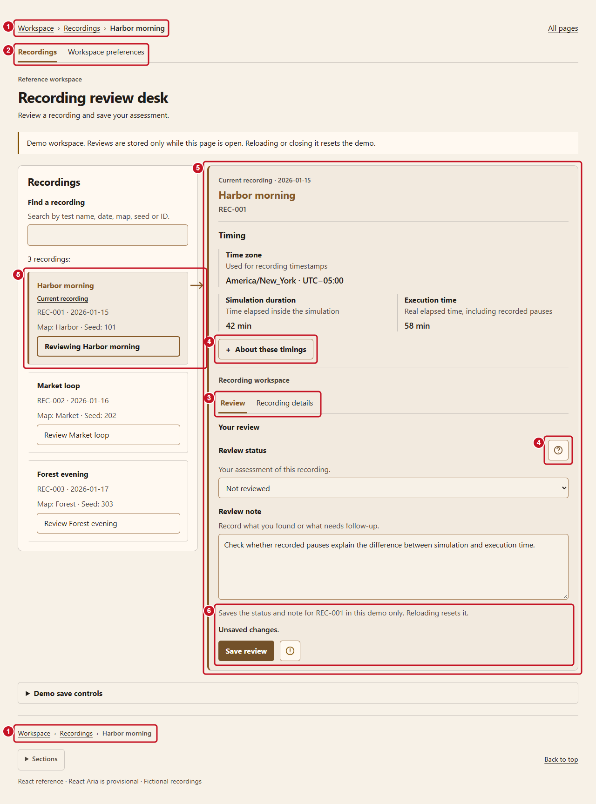
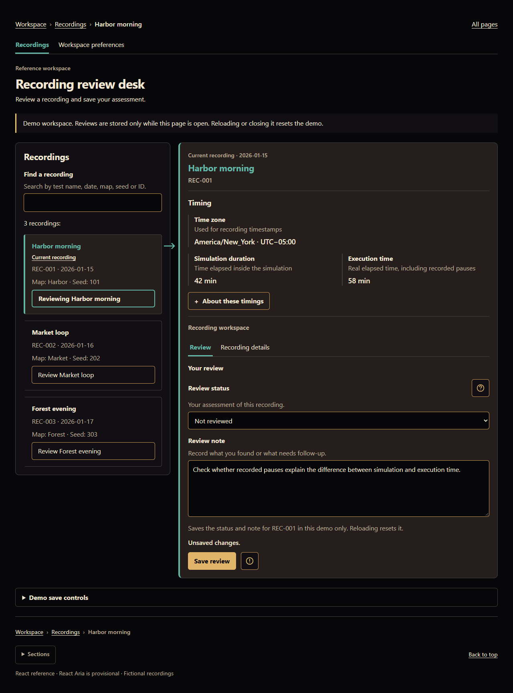
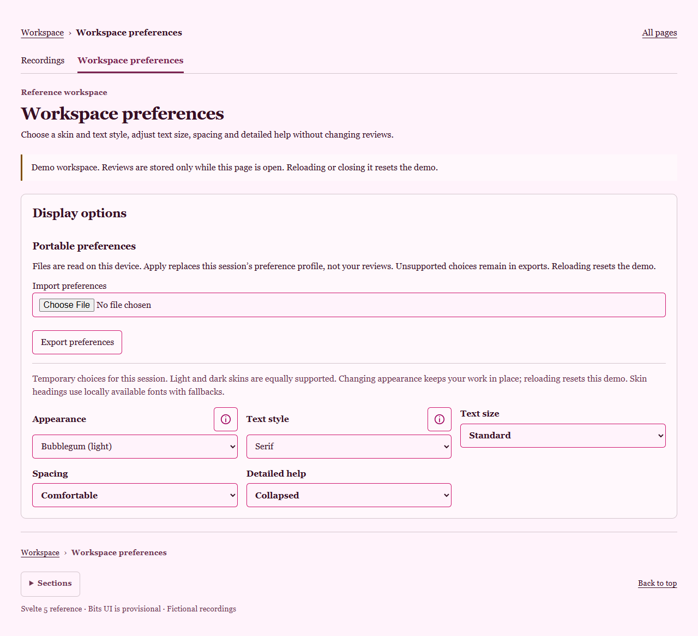
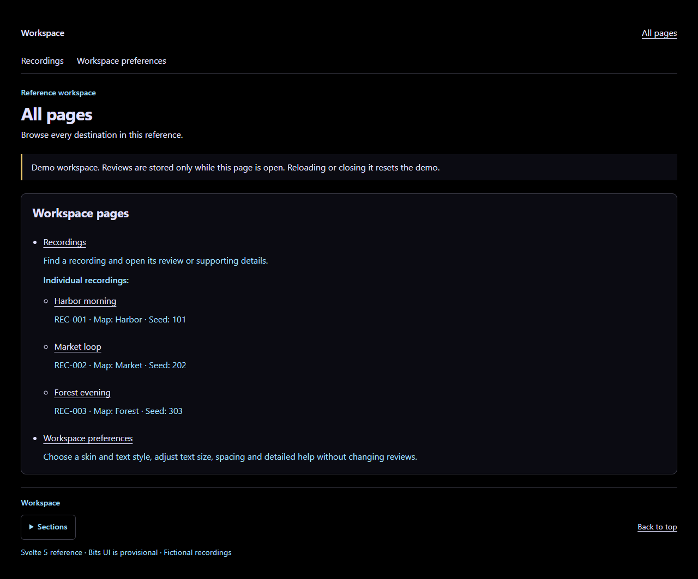

# Example screenshot gallery

See how the same interface principles work in different skins. These are full-page captures of the runnable references, with fictional data. **Start with the annotated light view** to see what the design is doing.

[Paperwhite walkthrough](#paperwhite-a-guided-tour) · [Guillermo review](#guillermo-the-same-work-in-a-dark-skin) · [Bubblegum preferences](#bubblegum-personal-appearance-choices) · [Cyberpunk directory](#cyberpunk-a-map-of-the-workspace)

## Paperwhite: a guided tour

**React · Paperwhite (light) · System text.** The user is reviewing Harbor morning and has an unsaved note. Red outlines and numbered markers are editorial annotations, not interface controls or error states.

1. **Breadcrumbs show ancestry.** Workspace → Recordings → Harbor morning appears at both the top and bottom, so users can orient themselves without scrolling back.
2. **Workspace navigation chooses a destination.** Recordings and Workspace preferences form the upper navigation level. The active destination has a visible underline.
3. **Local tabs choose a view of the current object.** Review and Recording details sit inside the recording workspace. They are subordinate views, not another set of global destinations.
4. **Optional explanation stays within reach.** “About these timings” expands supporting detail. The circled question-mark button offers clarification of review status. Essential timing meanings remain visible even when extra help is closed.
5. **The selected card and detail area belong together.** Matching surfaces, title colors and edge treatments connect them; the arrow points from the source toward its work area. Repeated identity and “Current recording” support recognition without color. “Reviewing Harbor morning” describes the current state.
6. **Save consequences are explicit.** The visible sentence explains that this demo saves only for the current page session. The circled exclamation-mark button offers additional explanation; it does not hide the limitation. “Unsaved changes” describes this draft honestly.

[Open the annotated view at full size](screenshots/react-paperwhite-annotated.png) · [Open the original screenshot without annotations](screenshots/gallery-react-paperwhite.png)

These patterns illustrate AUDHD-01, 02, 04, 05, 06, 08 and 09 in the [Guide](../GUIDE.md). The required outcome is understandable relationships and behavior; these particular boxes, colors and layout are examples.

## Guillermo: the same work in a dark skin

**React · Guillermo (dark) · System text.** Compare this with Paperwhite: the current recording, note, navigation and layout remain the same. The active-context color links the source card and detail area, while the Save review action has its own treatment. Changing appearance should preserve work and context.

[Open Guillermo at full size](screenshots/gallery-react-guillermo.png)

## Bubblegum: personal appearance choices

**Svelte 5 · Bubblegum (light) · Serif text.** Skin and text style are separate choices. Visible labels explain each setting, and circled information icons provide supplementary help. Import and export sit in a named Portable preferences section, with the local-file and session limits explained before the controls. The footer repeats orientation links in a compact form.

[Open Bubblegum at full size](screenshots/gallery-svelte-bubblegum.png)

## Cyberpunk: a map of the workspace

**Svelte 5 · Cyberpunk (dark) · System text.** All pages presents a hierarchical directory with a short explanation of each destination. Individual recordings appear beneath their parent collection, with identifiers and metadata to distinguish them. This is the canonical directory; multiple-category membership and cross-highlighting remain future work.

[Open Cyberpunk at full size](screenshots/gallery-svelte-cyberpunk.png)

The help icons are consistent SVG outlines that inherit each skin’s semantic colors. Their accessible button names and hover, keyboard and click/tap behavior remain independent of appearance.

## Explore and verify

- [Run React or Svelte locally](recording-review/README.md) to try navigation, help, review state and appearance changes. React Aria and Bits UI remain provisional choices.
- [Explore all 22 skins and chart palettes](skins/README.md). Light and dark appearances are personal choices, not universal AuDHD prescriptions.
- [Read acceptance results and pending checks](recording-review/ACCEPTANCE.md). Screenshots illustrate appearance; they do not establish keyboard accessibility, screen-reader usability or suitability for every person.

Captured October 19, 2026, using headless Chrome 155 on Windows at a 1280 × 900 CSS-pixel viewport, with full-page capture, Standard text size and Comfortable spacing. Full-page image heights vary. The [editable annotation source](screenshots/react-paperwhite-annotated.svg) preserves the original capture and adds vector outlines and numbers; the gallery displays its PNG rendering. Screenshots and annotations are documentation under [CC BY 4.0](../LICENSE_SCOPE.md).

[Return to README](../README.md)
